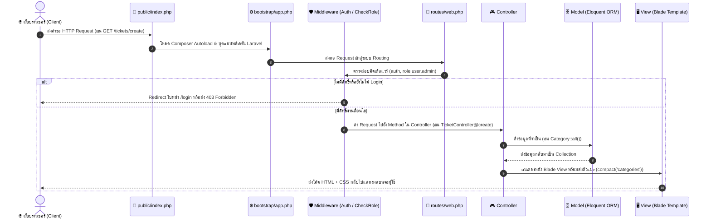
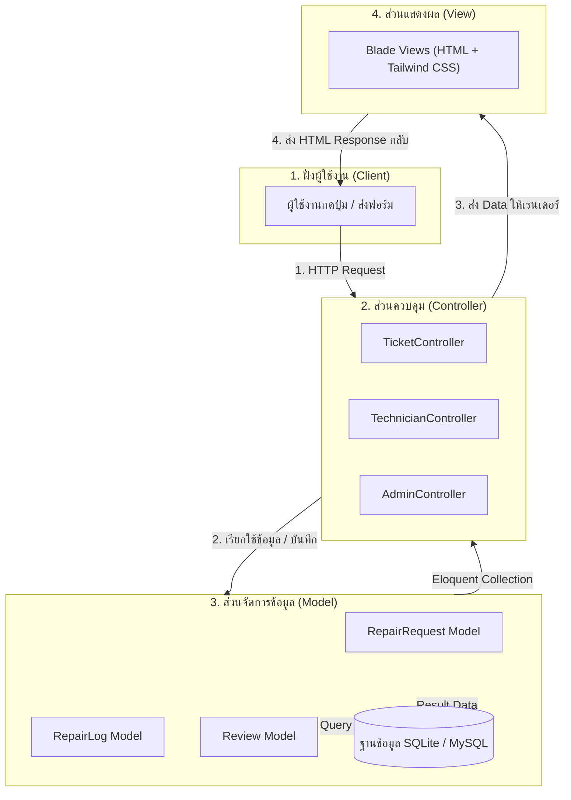
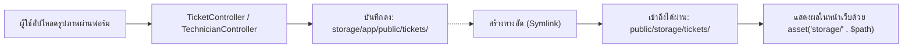

# 🚀 คู่มือสถาปัตยกรรมและการทำงานของ Laravel Framework
## โครงงานระบบแจ้งซ่อมบำรุงและจัดการอุปกรณ์ (Maintenance Repair System)

> **ฉบับสมบูรณ์สำหรับนักศึกษาใช้ศึกษาและตอบคำถามอาจารย์ผู้ตรวจประเมินโครงงาน**  
> เอกสารนี้สรุปแก่นการทำงานของ **Laravel 12**, สถาปัตยกรรม **MVC**, วงจรชีวิตของ Request, Eloquent ORM, ระบบความปลอดภัย, และคำสั่งสำคัญทั้งหมดที่ใช้จริงในโปรเจกต์นี้

---

## 📑 สารบัญ (Table of Contents)
1. [ภาพรวมโครงสร้างโฟลเดอร์ของ Laravel 12 (Directory Structure)](#1-ภาพรวมโครงสร้างโฟลเดอร์ของ-laravel-12-directory-structure)
2. [วงจรชีวิตคำขอ HTTP (Laravel Request Lifecycle)](#2-วงจรชีวิตคำขอ-http-laravel-request-lifecycle)
3. [สถาปัตยกรรม MVC ในโปรเจกต์นี้ (Model-View-Controller)](#3-สถาปัตยกรรม-mvc-ในโปรเจกต์นี้-model-view-controller)
4. [ระบบเส้นทางและมิดเดิลแวร์ (Routing & Middleware Architecture)](#4-ระบบเส้นทางและมิดเดิลแวร์-routing--middleware-architecture)
5. [ฐานข้อมูลและการใช้งาน Eloquent ORM (Database & Relationships)](#5-ฐานข้อมูลและการใช้งาน-eloquent-orm-database--relationships)
6. [ระบบตรวจสอบข้อมูลและความปลอดภัย (Validation & Security)](#6-ระบบตรวจสอบข้อมูลและความปลอดภัย-validation--security)
7. [การจัดการไฟล์และรูปภาพ (File Storage System)](#7-การจัดการไฟล์และรูปภาพ-file-storage-system)
8. [การทดสอบระบบอัตโนมัติ (Testing with PHPUnit / Pest)](#8-การทดสอบระบบอัตโนมัติ-testing-with-phpunit--pest)
9. [รวมคำสั่ง Artisan สำคัญที่ใช้บ่อย (Artisan CLI Cheat Sheet)](#9-รวมคำสั่ง-artisan-สำคัญที่ใช้บ่อย-artisan-cli-cheat-sheet)
10. [แนวทางการตอบคำถามอาจารย์ (Q&A Defense Guide)](#10-แนวทางการตอบคำถามอาจารย์-qa-defense-guide)

---

## 1. ภาพรวมโครงสร้างโฟลเดอร์ของ Laravel 12 (Directory Structure)

ใน Laravel 12 มีการจัดระเบียบไฟล์ให้กระชับและทันสมัย โดยโฟลเดอร์หลักในโปรเจกต์นี้ประกอบด้วย:

```text
example-app/
├── app/                            # หัวใจหลักของ Logic ระบบ (Application Core)
│   ├── Http/
│   │   ├── Controllers/            # คอนโทรลเลอร์ควบคุมการทำงานแต่ละโมดูล
│   │   │   ├── AdminController.php         # จัดการแดชบอร์ด จ่ายงาน ค้นหางาน
│   │   │   ├── AuthController.php          # เข้าสู่ระบบ สมัครสมาชิก ออกจากระบบ
│   │   │   ├── TechnicianController.php    # จัดการงานซ่อม อัปเดตสถานะ ปิดงาน
│   │   │   └── TicketController.php        # สร้างใบแจ้งซ่อม ติดตาม ยกเลิก ประเมินดาว
│   │   └── Middleware/
│   │       └── CheckRole.php       # กรองสิทธิ์ผู้ใช้งาน (RBAC: admin, technician, user)
│   ├── Models/                     # Data Models เชื่อมต่อฐานข้อมูลผ่าน Eloquent
│   │   ├── Category.php            # หมวดหมู่อุปกรณ์
│   │   ├── RepairLog.php           # บันทึกประวัติ Timeline การทำงาน
│   │   ├── RepairRequest.php       # ข้อมูลใบแจ้งซ่อมหลัก
│   │   ├── Review.php              # ข้อมูลการตรวจรับและประเมินดาว
│   │   └── User.php                # ข้อมูลผู้ใช้งานและบทบาท
│   └── Providers/
│       └── AppServiceProvider.php  # กำหนด Service Provider ค่าตั้งต้นของแอป
├── bootstrap/
│   └── app.php                     # จุดเริ่มต้นของแอปพลิเคชัน (Laravel 12 config routes & middleware)
├── config/                         # ไฟล์ตั้งค่าระบบ (auth, database, filesystems ฯลฯ)
├── database/
│   ├── migrations/                 # โครงสร้างตารางฐานข้อมูลแบบ Code-first
│   └── seeders/
│       └── DatabaseSeeder.php      # สคริปต์สร้างข้อมูลจำลองตั้งต้น
├── public/                         # โฟลเดอร์ที่เปิดสู่ภายนอก (Web Root)
│   ├── index.php                   # Entry Point แรกสุดของทุก Request
│   └── storage/                    # Symlink เชื่อมโยงรูปภาพไปยัง storage/app/public
├── resources/
│   └── views/                      # หน้าจอแสดงผลพัฒนาด้วย Blade Engine
│       ├── layouts/app.blade.php   # Layout โครงสร้างหลัก (Navbar, Alerts, Scripts)
│       ├── admin/                  # หน้าแดชบอร์ดและจัดการงานของแอดมิน
│       ├── auth/                   # หน้าเข้าสู่ระบบและสมัครสมาชิก
│       ├── technician/             # หน้ารายการงานของช่างซ่อม
│       └── tickets/                # หน้ารายการ สร้าง และแสดงรายละเอียดแจ้งซ่อม
├── routes/
│   └── web.php                     # กำหนดเส้นทาง URL ทั้งหมดของเว็บ
├── storage/                        # โฟลเดอร์เก็บแคช ล็อก และไฟล์ที่ผู้ใช้อัปโหลด
└── tests/                          # ชุดทดสอบระบบอัตโนมัติ (Automated Tests)
    └── Feature/
        └── RepairSystemContractTest.php # ชุดทดสอบ Business Logic ครบทุก Role
```

---

## 2. วงจรชีวิตคำขอ HTTP (Laravel Request Lifecycle)

เมื่อผู้ใช้งานเปิดหน้าเว็บหรือส่งแบบฟอร์ม (Form Submit) ในระบบ Laravel จะดำเนินการตามลำดับขั้นดังนี้:



### คำอธิบายแต่ละขั้นตอน:
1. **Entry Point (`public/index.php`)**: รับ HTTP Request ดิบทั้งหมดจากเว็บเซิร์ฟเวอร์
2. **Bootstrap (`bootstrap/app.php`)**: ใน Laravel 12 ทำหน้าที่เป็นศูนย์กลางกำหนดค่า Routing, Middleware, และ Exception Handling
3. **HTTP Middleware**: ด่านตรวจความปลอดภัย เช่น ตรวจสอบว่าล็อกอินหรือยัง (`auth`) หรือตรวจสอบบทบาท (`role:admin`)
4. **Controller**: รับคำขอ ตรวจสอบความถูกต้องของข้อมูล (Validation) และตัดสินใจว่าจะทำอะไร
5. **Eloquent Model**: จัดการดึง แก้ไข หรือบันทึกข้อมูลลงฐานข้อมูลผ่าน Object-Relational Mapping
6. **Blade View**: ประกอบหน้า HTML นำข้อมูลมาวนลูปหรือเช็คเงื่อนไข แล้วส่งกลับเป็น Response

---

## 3. สถาปัตยกรรม MVC ในโปรเจกต์นี้ (Model-View-Controller)

ระบบนี้ใช้รูปแบบ **MVC Design Pattern** เพื่อแยกการทำงานออกเป็นสัดส่วน ดูแลง่าย และรองรับการขยายตัว:



### การจับคู่การทำงานจริงในโปรเจกต์:

| องค์ประกอบ | ตัวอย่างไฟล์ในโค้ด | หน้าที่และการทำงาน |
| :--- | :--- | :--- |
| **Model** | [RepairRequest.php](file:///c:/xampp/htdocs/WEBDD_Miniproject/example-app/app/Models/RepairRequest.php) | นิยามความสัมพันธ์ ความหมายของฟิลด์ คอลัมน์ และการแปลงข้อมูล (`casts`) |
| **View** | [tickets/create.blade.php](file:///c:/xampp/htdocs/WEBDD_Miniproject/example-app/resources/views/tickets/create.blade.php) | หน้า UI ฟอร์มแจ้งซ่อม แสดงผลแจ้งเตือน Error และปรีวิวรูปภาพก่อนส่ง |
| **Controller** | [TicketController.php](file:///c:/xampp/htdocs/WEBDD_Miniproject/example-app/app/Http/Controllers/TicketController.php) | รับ Request ตรวจสอบความถูกต้อง บันทึกภาพลงดิสก์ สร้าง Ticket และเขียน Log |

---

## 4. ระบบเส้นทางและมิดเดิลแวร์ (Routing & Middleware Architecture)

### 4.1 การกำหนดกลุ่มเส้นทางตามบทบาท (Role-based Route Groups)
ใน [routes/web.php](file:///c:/xampp/htdocs/WEBDD_Miniproject/example-app/routes/web.php) มีการใช้ Route Grouping เพื่อป้องกันการเข้าถึงแบบไม่ได้รับอนุญาต:

```php
// กลุ่มเส้นทางสำหรับช่างซ่อม (Technician)
Route::middleware(['auth', 'role:technician'])->prefix('technician')->name('technician.')->group(function () {
    Route::get('/tasks', [TechnicianController::class, 'tasks'])->name('tasks');
    Route::patch('/tickets/{ticket}/status', [TechnicianController::class, 'updateStatus'])->name('tickets.updateStatus');
});

// กลุ่มเส้นทางสำหรับผู้ดูแลระบบ (Admin)
Route::middleware(['auth', 'role:admin'])->prefix('admin')->name('admin.')->group(function () {
    Route::get('/dashboard', [AdminController::class, 'dashboard'])->name('dashboard');
    Route::get('/tickets', [AdminController::class, 'tickets'])->name('tickets');
    Route::post('/tickets/{ticket}/assign', [AdminController::class, 'assign'])->name('tickets.assign');
});
```

### 4.2 กลไกการทำงานของ CheckRole Middleware
ใน [app/Http/Middleware/CheckRole.php](file:///c:/xampp/htdocs/WEBDD_Miniproject/example-app/app/Http/Middleware/CheckRole.php):

```php
public function handle(Request $request, Closure $next, ...$roles): Response
{
    // 1. ถ้ายังไม่ได้ล็อกอิน ให้กลับไปหน้า Login
    if (!Auth::check()) {
        return redirect()->route('login');
    }

    // 2. ตรวจสอบว่าบทบาท (role) ของผู้ใช้งานปัจจุบัน ตรงกับบทบาทที่ได้รับอนุญาตหรือไม่
    if (!in_array($request->user()->role, $roles)) {
        abort(403, 'คุณไม่มีสิทธิ์ในการเข้าถึงหน้านี้');
    }

    // 3. อนุญาตให้ส่งคำขอต่อไปยัง Controller
    return $next($request);
}
```

---

## 5. ฐานข้อมูลและการใช้งาน Eloquent ORM (Database & Relationships)

Eloquent ORM ทำให้การทำงานกับฐานข้อมูลเป็นแบบ **Object-Oriented** โดยไม่ต้องเขียน SQL ดิบเอง

### 5.1 ความสัมพันธ์แบบ One-to-Many (1:N)
ตัวอย่างความสัมพันธ์ใน [app/Models/RepairRequest.php](file:///c:/xampp/htdocs/WEBDD_Miniproject/example-app/app/Models/RepairRequest.php):

```php
class RepairRequest extends Model
{
    // ใบแจ้งซ่อม 1 ใบ เป็นของผู้ใช้ 1 คน (User)
    public function user()
    {
        return $this->belongsTo(User::class);
    }

    // ใบแจ้งซ่อม 1 ใบ ถูกมอบหมายให้ช่าง 1 คน (Technician)
    public function technician()
    {
        return $this->belongsTo(User::class, 'technician_id');
    }

    // ใบแจ้งซ่อม 1 ใบ มีประวัติการเปลี่ยนแปลงสถานะได้หลายรายการ (Logs)
    public function logs()
    {
        return $this->hasMany(RepairLog::class)->latest();
    }

    // ใบแจ้งซ่อม 1 ใบ มีการตรวจรับงานและประเมินดาวได้ 1 รีวิว
    public function review()
    {
        return $this->hasOne(Review::class);
    }
}
```

### 5.2 การใช้ Eager Loading ลดปัญหา N+1 Query
ใน Controller แทนที่จะ Query ฐานข้อมูลซ้ำซ้อนใน Loop ระบบใช้คำสั่ง `with()`:
```php
// ดึงข้อมูลพร้อมกับโมเดลที่เกี่ยวข้องในคิวรีเดียว มีประสิทธิภาพสูง
$tickets = RepairRequest::with(['category', 'technician'])
    ->where('user_id', Auth::id())
    ->latest()
    ->paginate(10);
```

---

## 6. ระบบตรวจสอบข้อมูลและความปลอดภัย (Validation & Security)

### 6.1 Form Request Validation
ใน [TicketController.php](file:///c:/xampp/htdocs/WEBDD_Miniproject/example-app/app/Http/Controllers/TicketController.php) มีการกำหนดกฎตรวจสอบข้อมูลก่อนทำการบันทึก:

```php
$validated = $request->validate([
    'category_id' => 'required|exists:categories,id', // ต้องมีค่า และต้องมีอยู่ในตาราง categories
    'title'       => 'required|string|max:255',        // ข้อความไม่เกิน 255 ตัวอักษร
    'description' => 'required|string',               // รายละเอียดห้ามว่าง
    'location'    => 'required|string|max:255',        // สถานที่แจ้งซ่อม
    'urgency'     => 'required|in:low,normal,high,urgent', // ค่าต้องตรงกับตัวเลือกที่กำหนดเท่านั้น
    'image_before'=> 'nullable|image|mimes:jpeg,png,jpg,webp|max:5120', // รูปภาพขนาดไม่เกิน 5MB
]);
```

### 6.2 มาตรการความปลอดภัยในระบบ (Built-in Security):
1. **CSRF Protection**: ทุกฟอร์ม POST/PUT/PATCH มี `@csrf` ป้องกันการโจมตีแบบ Cross-Site Request Forgery
2. **SQL Injection Protection**: Eloquent ORM และ Query Builder ใช้ PDO Parameter Binding อัตโนมัติ ป้องกันการแทรกโค้ด SQL แปลกปลอม 100%
3. **XSS Protection**: Blade Template ใช้ไวยากรณ์ `{{ $data }}` ซึ่งจะทำ `htmlspecialchars()` อัตโนมัติเพื่อป้องกัน JavaScript Malicious Injection
4. **Password Hashing**: รหัสผ่านถูกเข้ารหัสด้วยอัลกอริทึม Bcrypt ผ่านคลาส `Hash::make()` ปลอดภัยตามมาตรฐานสากล

---

## 7. การจัดการไฟล์และรูปภาพ (File Storage System)

ระบบรองรับการอัปโหลดรูปภาพ 2 ขั้นตอน: **รูปภาพก่อนซ่อม (Image Before)** และ **รูปภาพหลังซ่อมเสร็จ (Image After)**



### โค้ดคำสั่งบันทึกไฟล์:
```php
if ($request->hasFile('image_before')) {
    // บันทึกลงไดเรกทอรี public/tickets และคืนค่า path กลับมา
    $imagePath = $request->file('image_before')->store('tickets', 'public');
    $validated['image_before'] = $imagePath;
}
```

---

## 8. การทดสอบระบบอัตโนมัติ (Testing with PHPUnit / Pest)

ระบบมีชุดทดสอบครอบคลุม Contract และ Business Logic ใน [tests/Feature/RepairSystemContractTest.php](file:///c:/xampp/htdocs/WEBDD_Miniproject/example-app/tests/Feature/RepairSystemContractTest.php)

```text
✓ login redirects user to tickets index
✓ login redirects technician to technician tasks
✓ login redirects admin to admin dashboard
✓ user can create ticket with image
✓ user can cancel pending ticket
✓ admin can assign technician to ticket
✓ technician can update status and complete job
✓ user can review completed ticket and close it
✓ role authorization middleware protects routes
✓ user cannot view other user ticket
✓ user cannot cancel already assigned ticket
✓ admin can view tickets and filter
```

### การสั่งรันชุดทดสอบ:
```bash
php artisan test
```
*ผลลัพธ์: ผ่านครบ 28 Tests (89 Assertions) สำเร็จ 100%*

---

## 9. รวมคำสั่ง Artisan สำคัญที่ใช้บ่อย (Artisan CLI Cheat Sheet)

| คำสั่ง (Command) | หน้าที่และการใช้งาน |
| :--- | :--- |
| `php artisan serve` | เริ่มต้นเซิร์ฟเวอร์จำลองสำหรับรันเว็บแอปพลิเคชัน (Default Port: 8000) |
| `php artisan migrate` | สร้างหรืออัปเดตตารางฐานข้อมูลตามไฟล์ Migration |
| `php artisan migrate:fresh --seed` | ลบตารางทั้งหมด สร้างใหม่ และรัน Seeder เติมข้อมูลทดสอบตั้งต้น |
| `php artisan storage:link` | สร้าง Symbolic Link จาก `storage/app/public` มายัง `public/storage` เพื่อให้ดูรูปภาพผ่านเว็บได้ |
| `php artisan route:list` | แสดงรายการ URL, Controller, และ Middleware ทั้งหมดของระบบ |
| `php artisan test` | รันชุดการทดสอบระบบอัตโนมัติ (Automated Tests) ทั้งหมด |
| `php artisan optimize:clear` | ล้างไฟล์แคชทั้งหมดของระบบ (Route, Config, Cache, View) |
| `php artisan make:controller NameController` | สร้างไฟล์ Controller ใหม่ในโฟลเดอร์ `app/Http/Controllers` |
| `php artisan make:model Name -m` | สร้างไฟล์ Model พร้อมสร้างไฟล์ Database Migration ควบคู่กัน |

---

## 10. แนวทางการตอบคำถามอาจารย์ (Q&A Defense Guide)

### ❓ คำถามที่ 1: "ระบบนี้ป้องกันไม่ให้ User ทั่วไปแอบเข้ามาดูหน้า Admin ได้อย่างไร?"
> **แนวทางการตอบ:**  
> "ระบบใช้ **Middleware** ชื่อ `CheckRole` ครับ โดยผูกไว้ที่กลุ่มเส้นทางใน `routes/web.php` ด้วยคำสั่ง `Route::middleware(['auth', 'role:admin'])` ซึ่งตัว Middleware จะทำการตรวจสอบคอลัมน์ `role` ของผู้ใช้ที่กำลังล็อกอิน หากไม่ใช่ `admin` ระบบจะหยุดการทำงานและคืนค่า **HTTP 403 Forbidden** ทันที ทำให้ไม่สามารถเข้าถึงหน้าหรือเรียกใช้งาน Controller ของแอดมินได้ครับ"

---

### ❓ คำถามที่ 2: "ทำไมรูปภาพที่อัปโหลดไม่ถูกเก็บไว้ในโฟลเดอร์ `public` โดยตรง?"
> **แนวทางการตอบ:**  
> "เพื่อความปลอดภัยและความเป็นระเบียบตามมาตรฐานของ Laravel ครับ โดย Laravel จะจัดเก็บไฟล์จริงไว้ที่ `storage/app/public/` เพื่อป้องกันการเข้าถึงสคริปต์อันตรายโดยตรง จากนั้นใช้คำสั่ง `php artisan storage:link` เพื่อสร้าง Symbolic Link เชื่อมต่อไปยัง `public/storage/` ทำให้เราสามารถแสดงผลรูปภาพผ่านบราวเซอร์ได้อย่างปลอดภัยครับ"

---

### ❓ คำถามที่ 3: "หากช่างซ่อมกดบันทึกงานซ่อม ข้อมูลประวัติ Timeline ถูกบันทึกอย่างไร?"
> **แนวทางการตอบ:**  
> "เมื่อช่างกดเปลี่ยนสถานะหรือบันทึกค่าใช้จ่ายใน `TechnicianController` ระบบจะทำการอัปเดตสถานะในตาราง `repair_requests` และในขณะเดียวกันจะสร้าง Record ใหม่ลงในตาราง `repair_logs` เสมอ เพื่อบันทึกประวัติว่าใครเป็นผู้ดำเนินการ เปลี่ยนจากสถานะอะไรเป็นสถานะอะไร ในวันและเวลาใด ทำให้เกิดระบบ Audit Trail หรือ Timeline ติดตามงานได้แบบ Real-time ครับ"
