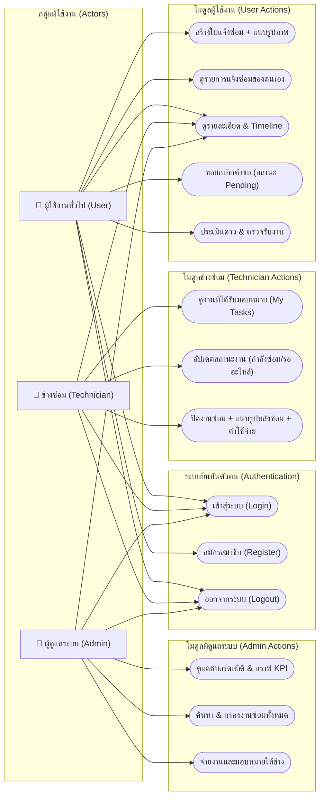
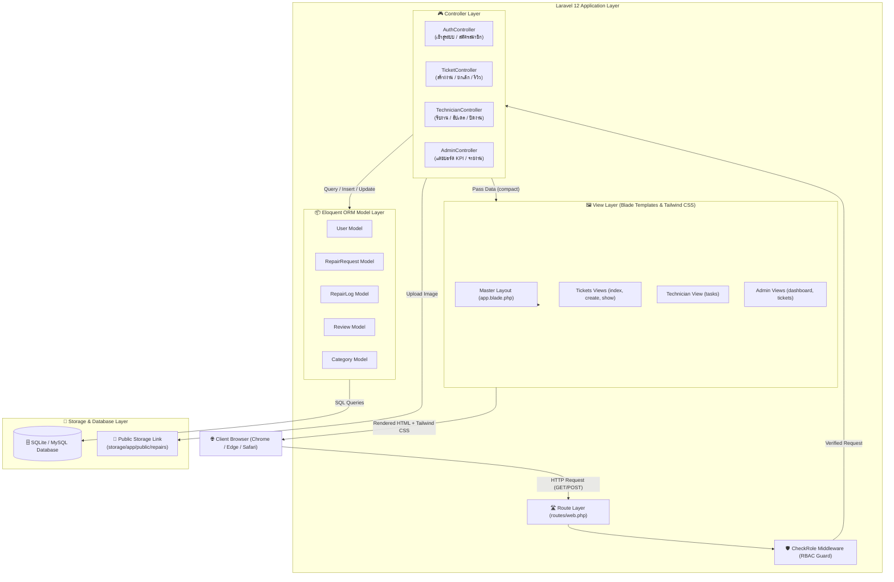
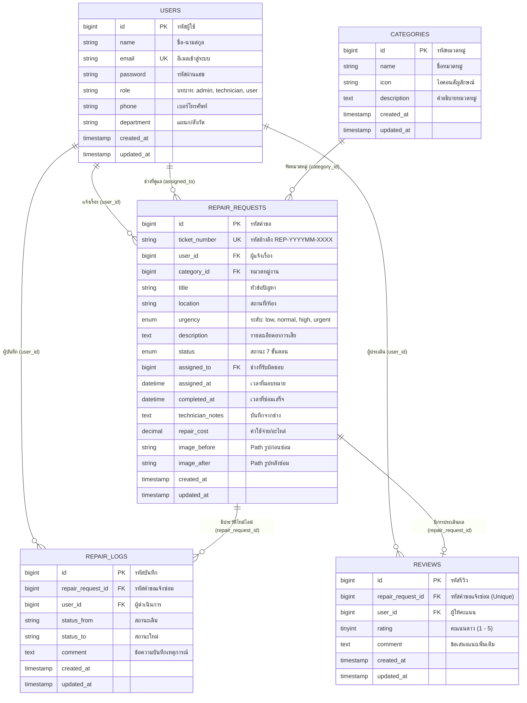
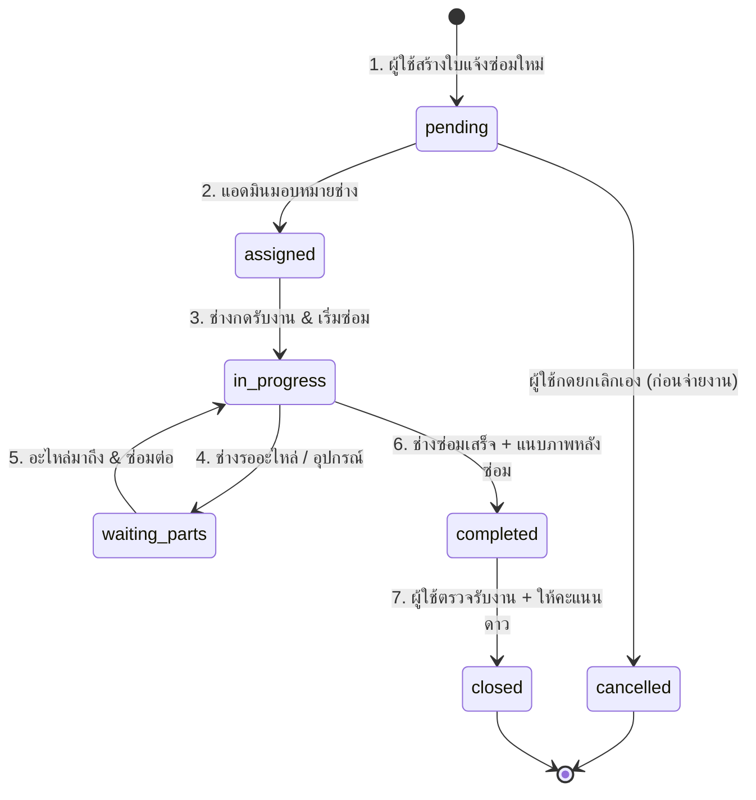
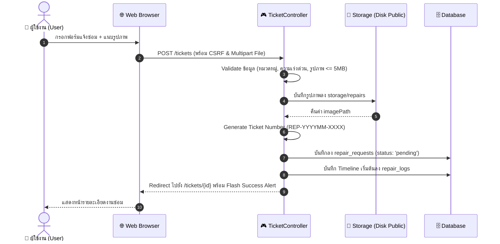
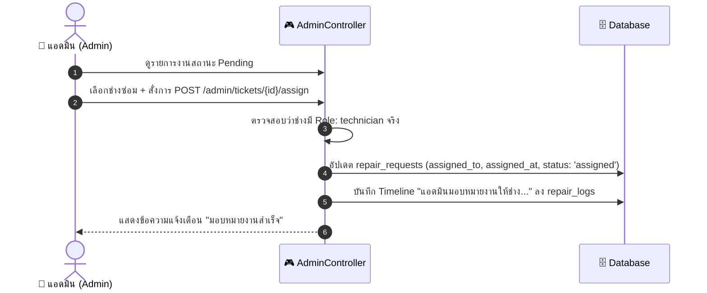
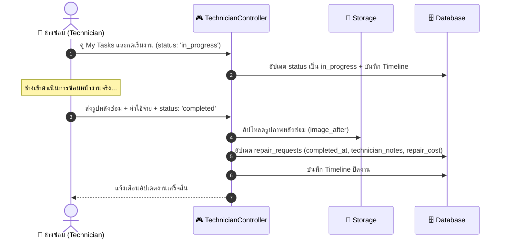
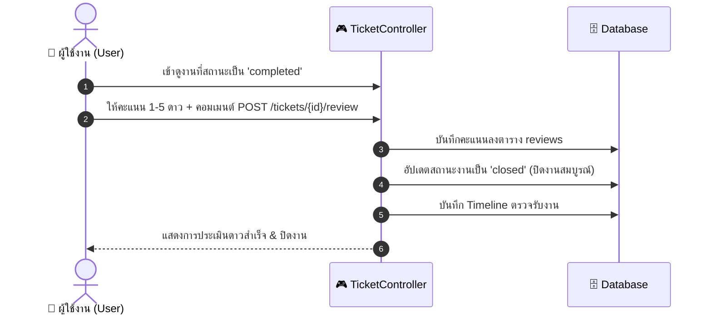

# 🛠️ เอกสารสถาปัตยกรรมและแผนผังระบบแจ้งซ่อมบำรุง (Maintenance Repair System Documentation)

> **โครงงาน:** ระบบแจ้งซ่อมบำรุงและจัดการอุปกรณ์ภายในองค์กร (Maintenance Repair System)  
> **เทคโนโลยี:** Laravel 12 • Blade Template Engine • Tailwind CSS • SQLite / MySQL • PHP 8.2+  
> **วัตถุประสงค์:** ใช้ประกอบการนำเสนอโครงงาน (Presentation) ให้อาจารย์และคณะกรรมการตรวจประเมิน เพื่อแสดงสถาปัตยกรรมระบบ แผนผังฐานข้อมูล ลำดับการทำงาน (Workflows) และการทดสอบระบบอัตโนมัติ

---

## 📑 สารบัญ (Table of Contents)
1. [ภาพรวมของระบบและบทบาทผู้ใช้งาน (System Overview & Roles)](#1-ภาพรวมของระบบและบทบาทผู้ใช้งาน-system-overview--roles)
2. [แผนภาพ Use Case ของระบบ (Use Case Diagram)](#2-แผนภาพ-use-case-ของระบบ-use-case-diagram)
3. [สถาปัตยกรรมระบบ (System Architecture Diagram)](#3-สถาปัตยกรรมระบบ-system-architecture-diagram)
4. [แผนผังฐานข้อมูลและความสัมพันธ์ (Entity Relationship Diagram - ERD)](#4-แผนผังฐานข้อมูลและความสัมพันธ์-entity-relationship-diagram---erd)
5. [วงจรสถานะงานแจ้งซ่อม (Ticket Lifecycle & State Machine)](#5-วงจรสถานะงานแจ้งซ่อม-ticket-lifecycle--state-machine)
6. [ลำดับการทำงานของระบบ (Sequence Diagrams)](#6-ลำดับการทำงานของระบบ-sequence-diagrams)
7. [พจนานุกรมข้อมูล (Data Dictionary & Schema)](#7-พจนานุกรมข้อมูล-data-dictionary--schema)
8. [ตารางเส้นทางและการควบคุมสิทธิ์ (Route & Permission Matrix)](#8-ตารางเส้นทางและการควบคุมสิทธิ์-route--permission-matrix)
9. [การทดสอบระบบอัตโนมัติ (Automated Testing & Quality Assurance)](#9-การทดสอบระบบอัตโนมัติ-automated-testing--quality-assurance)
10. [คู่มือการติดตั้งและข้อมูลบัญชีทดสอบ (Setup & Test Credentials)](#10-คู่มือการติดตั้งและข้อมูลบัญชีทดสอบ-setup--test-credentials)

---

## 1. ภาพรวมของระบบและบทบาทผู้ใช้งาน (System Overview & Roles)

ระบบแจ้งซ่อมบำรุงถูกออกแบบตามหลักสถาปัตยกรรม **MVC (Model-View-Controller)** และการควบคุมสิทธิ์ตามบทบาท **RBAC (Role-Based Access Control)** โดยแบ่งผู้ใช้งานออกเป็น 3 กลุ่มหลัก:

| บทบาท (Role) | สัญลักษณ์ | หน้าที่และความรับผิดชอบหลักในระบบ |
| :--- | :---: | :--- |
| **1. ผู้ใช้งานทั่วไป (User)** | 👤 | • ส่งเรื่องแจ้งซ่อมใหม่ พร้อมระบุสถานที่ หมวดหมู่ ความเร่งด่วน และแนบรูปภาพก่อนซ่อม<br>• ติดตามสถานะงานและประวัติ Timeline แบบ Real-time<br>• ขอยกเลิกคำขอได้ด้วยตนเอง (เฉพาะตอนสถานะรอดำเนินการ)<br>• ตรวจรับงานและให้คะแนนความพึงพอใจ (1-5 ดาว) เพื่อปิดงาน |
| **2. ช่างซ่อม (Technician)** | 🔧 | • ดูรายการงานที่ได้รับมอบหมาย (My Tasks)<br>• อัปเดตสถานะงาน (กำลังดำเนินการ / รออะไหล่ / ซ่อมเสร็จสิ้น)<br>• บันทึกวิธีซ่อม อะไหล่ที่เปลี่ยน และระบุค่าใช้จ่าย<br>• แนบรูปถ่ายหลังซ่อมเสร็จ (Image After) เพื่อเป็นหลักฐานปิดงาน |
| **3. ผู้ดูแลระบบ (Admin)** | 👑 | • ตรวจสอบสถิติภาพรวมผ่าน Dashboard (ตัวเลข KPI 5 รายการ และชาร์ตแจกแจง)<br>• ค้นหาและกรองรายการงานทั้งหมดในองค์กรแบบ Multi-filter<br>• สั่งมอบหมายงาน (Dispatch/Assign) ให้ช่างที่เหมาะสมพร้อมบันทึกคำสั่งการ |

---

## 2. แผนภาพ Use Case ของระบบ (Use Case Diagram)

แผนภาพแสดงฟังก์ชันการทำงานที่แต่ละกลุ่มผู้ใช้งานสามารถกระทำได้ในระบบ:



---

## 3. สถาปัตยกรรมระบบ (System Architecture Diagram)

ระบบทำงานบนโครงสร้าง **Laravel MVC Architecture** ควบคู่กับ **CheckRole Middleware** ในการคัดกรองคำขอ:



---

## 4. แผนผังฐานข้อมูลและความสัมพันธ์ (Entity Relationship Diagram - ERD)

ฐานข้อมูลถูกออกแบบตามหลัก Normalization มีความสัมพันธ์ 1:N และ 1:1 ครอบคลุมการทำงานทุกส่วน:



---

## 5. วงจรสถานะงานแจ้งซ่อม (Ticket Lifecycle & State Machine)

สถานะงานซ่อมมีทั้งหมด 7 สถานะ ดำเนินการตามลำดับขั้นตอน (Workflow Lifecycle) ดังนี้:



---

## 6. ลำดับการทำงานของระบบ (Sequence Diagrams)

### 6.1 ขั้นตอนที่ 1: ผู้ใช้งานส่งเรื่องแจ้งซ่อมใหม่ (Create Ticket)


### 6.2 ขั้นตอนที่ 2: แอดมินตรวจสอบและมอบหมายงานให้ช่าง (Assign Technician)


### 6.3 ขั้นตอนที่ 3: ช่างซ่อมดำเนินการและปิดงาน (Technician Work & Complete)


### 6.4 ขั้นตอนที่ 4: ผู้ใช้ตรวจรับงานและประเมินความพึงพอใจ (Review & Close)


---

## 7. พจนานุกรมข้อมูล (Data Dictionary & Schema)

### 7.1 ตาราง `repair_requests`
| ชื่อคอลัมน์ | ชนิดข้อมูล | คุณสมบัติ | คำอธิบาย |
| :--- | :--- | :--- | :--- |
| `id` | BIGINT | PK, Auto Increment | รหัสประจำรายการ |
| `ticket_number` | VARCHAR(50) | Unique, Not Null | รหัสอ้างอิง เช่น `REP-202610-0001` |
| `user_id` | BIGINT | FK (users.id), Cascade | รหัสผู้แจ้งซ่อม |
| `category_id` | BIGINT | FK (categories.id) | รหัสหมวดหมู่งานซ่อม |
| `title` | VARCHAR(255) | Not Null | หัวข้อปัญหา / ชื่ออุปกรณ์ |
| `location` | VARCHAR(255) | Not Null | สถานที่ / อาคาร / ชั้น / ห้อง |
| `urgency` | ENUM | Not Null, Default: 'normal' | ระดับความเร่งด่วน (`low`, `normal`, `high`, `urgent`) |
| `description` | TEXT | Not Null | รายละเอียดอาการชำรุด |
| `status` | ENUM | Not Null, Default: 'pending' | สถานะงาน 7 ขั้นตอน |
| `assigned_to` | BIGINT | FK (users.id), Nullable | ช่างผู้รับผิดชอบ |
| `assigned_at` | DATETIME | Nullable | วันเวลาที่จ่ายงานให้ช่าง |
| `completed_at` | DATETIME | Nullable | วันเวลาที่ช่างซ่อมเสร็จ |
| `technician_notes`| TEXT | Nullable | บันทึกสิ่งที่ซ่อม / อะไหล่ที่เปลี่ยน |
| `repair_cost` | DECIMAL(10,2)| Default: 0.00 | ค่าใช้จ่ายรวม / ค่าอะไหล่ |
| `image_before` | VARCHAR(255) | Nullable | พาธไฟล์ภาพถ่ายก่อนซ่อม |
| `image_after` | VARCHAR(255) | Nullable | พาธไฟล์ภาพถ่ายหลังซ่อม |
| `created_at` | TIMESTAMP | Nullable | วันเวลาที่ส่งคำขอ |
| `updated_at` | TIMESTAMP | Nullable | วันเวลาที่แก้ไขล่าสุด |

---

## 8. ตารางเส้นทางและการควบคุมสิทธิ์ (Route & Permission Matrix)

| Method | URI Path | Route Name | Controller Action | สิทธิ์ที่เข้าถึงได้ | หน้าที่การทำงาน |
| :---: | :--- | :--- | :--- | :---: | :--- |
| **GET** | `/login` | `login` | `AuthController@showLogin` | Guest | แสดงฟอร์มเข้าสู่ระบบ |
| **POST** | `/login` | `login.submit` | `AuthController@login` | Guest | ยืนยันการเข้าสู่ระบบ |
| **POST** | `/logout` | `logout` | `AuthController@logout` | Authenticated | ออกจากระบบ |
| **GET** | `/register` | `register` | `AuthController@showRegister` | Guest | แสดงฟอร์มสมัครสมาชิก |
| **POST** | `/register` | - | `AuthController@register` | Guest | บันทึกการสมัครสมาชิกใหม่ |
| **GET** | `/dashboard`| `dashboard` | Inline Closure | Authenticated | กระจายหน้าแรกตาม Role |
| **GET** | `/tickets` | `tickets.index` | `TicketController@index` | `user`, `admin` | รายการคำขอของตนเอง |
| **GET** | `/tickets/create` | `tickets.create` | `TicketController@create` | `user`, `admin` | ฟอร์มสร้างใบแจ้งซ่อมใหม่ |
| **POST** | `/tickets` | `tickets.store` | `TicketController@store` | `user`, `admin` | บันทึกการแจ้งซ่อมใหม่ |
| **GET** | `/tickets/{ticket}` | `tickets.show` | `TicketController@show` | ทุก Role ที่เกี่ยวข้อง | ดูรายละเอียด & Timeline |
| **POST** | `/tickets/{ticket}/cancel` | `tickets.cancel` | `TicketController@cancel` | `user` | ขอยกเลิกงาน (ตอน Pending) |
| **POST** | `/tickets/{ticket}/review` | `tickets.review` | `TicketController@review` | `user` | ให้คะแนนประเมินดาวปิดงาน |
| **GET** | `/technician/tasks` | `tech.tasks` | `TechnicianController@index` | `technician` | รายการงานที่ช่างได้รับมอบหมาย |
| **POST** | `/technician/tasks/{ticket}/status` | `tech.updateStatus` | `TechnicianController@updateStatus` | `technician`, `admin` | อัปเดตสถานะงาน / ปิดงาน |
| **GET** | `/admin/dashboard` | `admin.dashboard` | `AdminController@dashboard` | `admin` | แดชบอร์ดสรุปสถิติ & KPI |
| **GET** | `/admin/tickets` | `admin.tickets.index` | `AdminController@tickets` | `admin` | จัดการงานทั้งหมด & ค้นหา |
| **POST** | `/admin/tickets/{ticket}/assign` | `admin.tickets.assign` | `AdminController@assign` | `admin` | มอบหมายงานให้ช่าง |

---

## 9. การทดสอบระบบอัตโนมัติ (Automated Testing & Quality Assurance)

ระบบมาพร้อมชุดทดสอบอัตโนมัติ (Automated Feature Tests) ทั้งหมด **28 Tests (89 Assertions)** รันผ่าน 100%:

```bash
php artisan test
```

### รายการทดสอบหลักใน `RepairSystemContractTest.php`:
1. `test_login_redirects_user_to_tickets_index`: ตรวจสอบการนำทางของ User ไป `/tickets`
2. `test_login_redirects_technician_to_technician_tasks`: ตรวจสอบการนำทางของ ช่าง ไป `/technician/tasks`
3. `test_login_redirects_admin_to_admin_dashboard`: ตรวจสอบการนำทางของ แอดมิน ไป `/admin/dashboard`
4. `test_user_can_create_ticket_with_image`: ตรวจสอบการบันทึกงานซ่อมพร้อมอัปโหลดรูปภาพ
5. `test_user_can_cancel_pending_ticket`: ตรวจสอบการยกเลิกงานตอน Pending
6. `test_admin_can_assign_technician_to_ticket`: ตรวจสอบการจ่ายงานให้ช่าง
7. `test_technician_can_update_status_and_complete_job`: ตรวจสอบการเปลี่ยนสถานะและการแนบรูปหลังซ่อม
8. `test_user_can_review_completed_ticket_and_close_it`: ตรวจสอบการให้คะแนนดาว 1-5 และเปลี่ยนสถานะเป็น Closed
9. `test_role_authorization_middleware_protects_routes`: ป้องกันการข้ามสิทธิ์ตอบกลับ 403 Forbidden
10. `test_user_cannot_view_other_user_ticket`: ป้องกันไม่ให้ผู้ใช้แอบเปิดดูงานของผู้อื่น
11. `test_user_cannot_cancel_already_assigned_ticket`: ป้องกันไม่ให้ยกเลิกงานที่จ่ายงานไปแล้ว
12. `test_admin_can_view_tickets_and_filter`: ตรวจสอบฟังก์ชันการค้นหาและกรองงานของแอดมิน

---

## 10. คู่มือการติดตั้งและข้อมูลบัญชีทดสอบ (Setup & Test Credentials)

### การติดตั้งและเริ่มใช้งาน (Installation Steps)
```bash
# 1. คัดลอกไฟล์ Environment
cp .env.example .env

# 2. สร้าง Application Key
php artisan key:generate

# 3. เชื่อมโยง Storage Link สำหรับรูปภาพ
php artisan storage:link

# 4. รัน Database Migration และจำลองข้อมูลเริ่มต้น (Seeder)
php artisan migrate:fresh --seed

# 5. เริ่มต้นเซิร์ฟเวอร์
php artisan serve
```

### ข้อมูลผู้ใช้งานสำหรับทดสอบระบบ (รหัสผ่านคือ `password` ทุกบัญชี)
| บทบาท (Role) | อีเมล (Email) | รหัสผ่าน | สิทธิ์และการทดสอบ |
| :--- | :--- | :--- | :--- |
| **ผู้ดูแลระบบ (Admin)** | `admin@repair.test` | `password` | เข้าดูแดชบอร์ด KPI, จ่ายงานให้ช่าง, กรองค้นหางานทั้งหมด |
| **ช่างซ่อม (Technician)** | `tech@repair.test` | `password` | รับงานซ่อม, อัปเดตสถานะ, แนบรูปหลังซ่อม, ระบุค่าใช้จ่าย |
| **ผู้ใช้งานทั่วไป (User)** | `user@repair.test` | `password` | แจ้งซ่อมใหม่, ติดตามประวัติ, ตรวจรับงานและให้คะแนนดาว |
