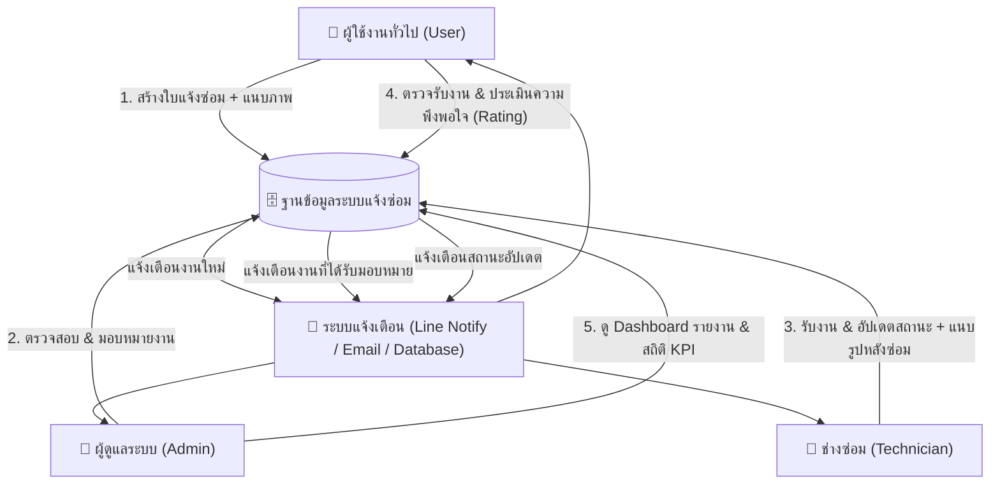
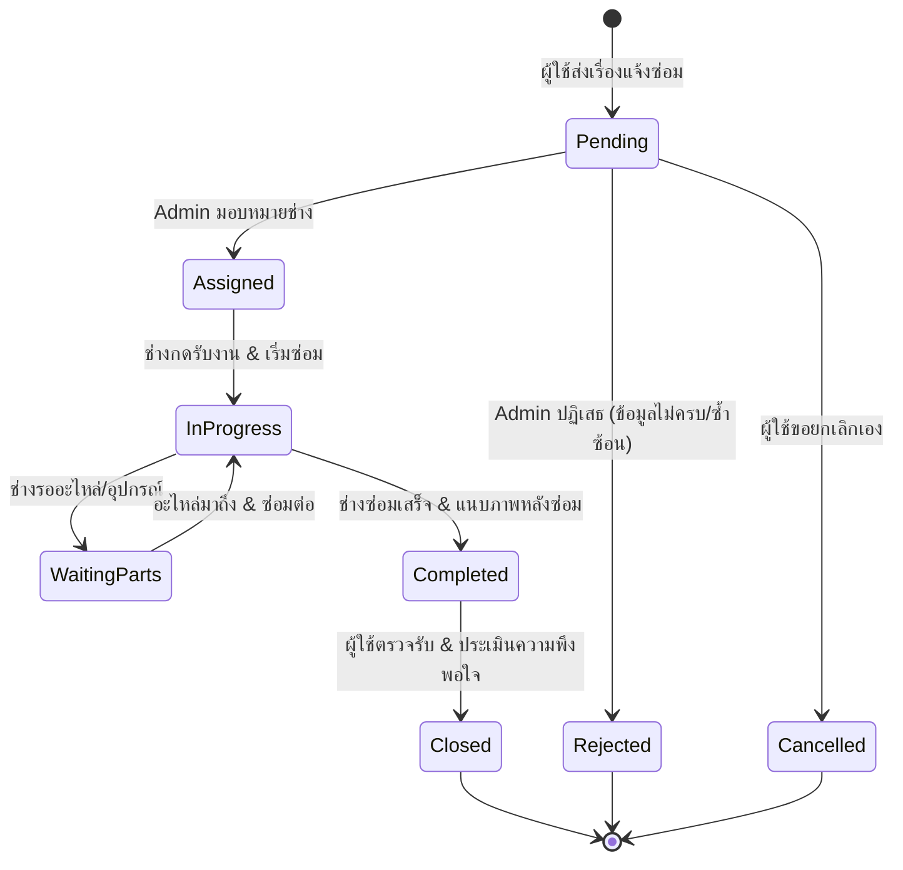
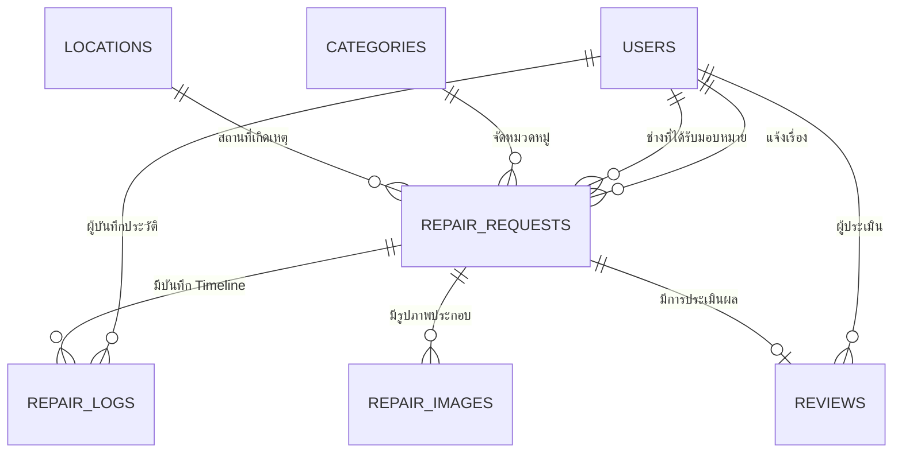

# 🛠️ พิมพ์เขียวระบบแจ้งซ่อม (Repair Maintenance System) ด้วย Laravel

เอกสารฉบับนี้ออกแบบสถาปัตยกรรมและโครงสร้างระบบแจ้งซ่อมแบบครบวงจร รองรับ 3 กลุ่มผู้ใช้งาน (Actors): **ผู้ใช้งานทั่วไป (User)**, **ช่างซ่อม (Technician)**, และ **ผู้ดูแลระบบ (Admin)**

---

## 1. ภาพรวมสถาปัตยกรรมและความรับผิดชอบของแต่ละ Actor



### หน้าที่และความรับผิดชอบ (Role & Responsibilities)

| Actor | หน้าที่หลัก (Core Features) | สิ่งที่มองเห็น/ทำได้ในระบบ |
| :--- | :--- | :--- |
| **1. ผู้ใช้งานทั่วไป (User)** | แจ้งปัญหา, ติดตามสถานะ, ประเมินงาน | - กรอกฟอร์มแจ้งซ่อม (เลือกหมวดหมู่, สถานที่, อาการ, แนบรูปภาพ 1-5 รูป)<br>- ดูประวัติและ Timeline สถานะงานของตนเองแบบ Real-time<br>- กดยกเลิกคำขอ (ได้เฉพาะสถานะ "รอดำเนินการ")<br>- ให้คะแนนดาว (1-5) และข้อเสนอแนะเมื่องานเสร็จสิ้น |
| **2. ช่างซ่อม (Technician)** | รับงาน, ดำเนินการซ่อม, ปิดงาน | - รายการงานที่ได้รับมอบหมาย (My Tasks)<br>- กด "รับงาน" (เปลี่ยนเป็น In Progress)<br>- บันทึกอาการตรวจพบ, วิธีแก้ไข, อะไหล่/ค่าใช้จ่ายที่ใช้<br>- แนบรูปถ่ายก่อนซ่อม/หลังซ่อม (Before & After)<br>- เปลี่ยนสถานะ (กำลังซ่อม / รออะไหล่ / ซ่อมเสร็จสิ้น) |
| **3. ผู้ดูแลระบบ (Admin)** | บริหารจัดการ, มอบหมายงาน, รายงาน | - Dashboard สรุปสถิติ (งานค้าง, ซ่อมเสร็จ, เวลาเฉลี่ย, คะแนนประเมิน)<br>- จัดคิวและมอบหมายงานให้ช่างที่เหมาะสม (Dispatch / Assign)<br>- จัดการข้อมูลพื้นฐาน (หมวดหมู่อุปกรณ์, อาคาร/สถานที่, ผู้ใช้งาน)<br>- ออกรายงาน Export (Excel / PDF) รายเดือน/รายไตรมาส |

---

## 2. ลำดับสถานะงานซ่อม (Ticket Status Lifecycle)



---

## 3. การออกแบบฐานข้อมูล (Database Schema / ERD)



### โครงสร้างตารางหลัก (Tables Specification)

#### 1) `users`
- `id` (PK, BigInt)
- `name` (String)
- `email` (String, Unique)
- `password` (String)
- `phone` (String, Nullable)
- `role` (Enum: `'user'`, `'technician'`, `'admin'`) หรือใช้ Spatie Role
- `department` (String, Nullable)
- `avatar` (String, Nullable)
- `timestamps`

#### 2) `categories` (หมวดหมู่งานซ่อม เช่น ไฟฟ้า, ประปา, คอมพิวเตอร์/ไอที, แอร์)
- `id` (PK)
- `name` (String: เช่น "ระบบไฟฟ้าและแสงสว่าง")
- `icon` (String: เช่น icon class หรือ SVG)
- `description` (Text, Nullable)
- `timestamps`

#### 3) `locations` (สถานที่/อาคาร/ห้อง)
- `id` (PK)
- `building` (String: เช่น "อาคาร 1")
- `floor` (String: เช่น "ชั้น 3")
- `room` (String: เช่น "ห้อง 302")
- `description` (String, Nullable)
- `timestamps`

#### 4) `repair_requests` (ตารางหัวใจของระบบ: ใบแจ้งซ่อม)
- `id` (PK)
- `ticket_number` (String, Unique: เช่น `REP-202610-001`)
- `user_id` (FK -> users: ผู้แจ้ง)
- `category_id` (FK -> categories)
- `location_id` (FK -> locations, Nullable หรือกรอกที่อยู่เพิ่มเติม)
- `location_detail` (String: เช่น โต๊ะทำงานริมหน้าต่าง)
- `title` (String: หัวข้อปัญหา เช่น "หลอดไฟกะพริบ")
- `description` (Text: รายละเอียดของปัญหา)
- `urgency` (Enum: `'low'`, `'normal'`, `'high'`, `'urgent'`)
- `status` (Enum: `'pending'`, `'assigned'`, `'in_progress'`, `'waiting_parts'`, `'completed'`, `'closed'`, `'rejected'`, `'cancelled'`)
- `assigned_to` (FK -> users: ช่างที่ดูแล, Nullable)
- `assigned_at` (DateTime, Nullable)
- `completed_at` (DateTime, Nullable)
- `repair_cost` (Decimal, Default: 0.00)
- `timestamps`

#### 5) `repair_images` (รูปภาพประกอบ)
- `id` (PK)
- `repair_request_id` (FK -> repair_requests, On Delete Cascade)
- `file_path` (String)
- `type` (Enum: `'before'`, `'after'`)
- `timestamps`

#### 6) `repair_logs` (Timeline Audit Trail)
- `id` (PK)
- `repair_request_id` (FK -> repair_requests, On Delete Cascade)
- `user_id` (FK -> users: ผู้กระทำการ)
- `status_from` (String, Nullable)
- `status_to` (String)
- `comment` (Text, Nullable: หมายเหตุ เช่น "สั่งซื้ออะไหล่ รอสินค้า 2 วัน")
- `timestamps`

#### 7) `reviews` (การประเมินความพึงพอใจ)
- `id` (PK)
- `repair_request_id` (FK -> repair_requests, Unique)
- `user_id` (FK -> users: ผู้ประเมิน)
- `rating` (TinyInt: 1 - 5 ดาว)
- `comment` (Text, Nullable)
- `timestamps`

---

## 4. แผนงานการพัฒนาแบบจับมือทำ 9 ขั้นตอน (Step-by-Step Roadmap)

```
[Phase 1] ติดตั้งและตั้งค่าสภาพแวดล้อม (Environment & Setup)
  ├─ ติดตั้ง Laravel ด้วย Composer ใน XAMPP
  ├─ ตั้งค่า .env เชื่อมต่อ MySQL Database (phpMyAdmin)
  └─ ติดตั้ง Authentication Starter Kit (Breeze / Filament / Spatie)

[Phase 2] ออกแบบ Database & Migrations & Seeders
  ├─ สร้าง Model + Migration 7 ตาราง
  ├─ กำหนด Eloquent Relationships (hasMany, belongsTo)
  └─ สร้าง DatabaseSeeder สุ่มข้อมูลตัวอย่าง (Dummy Users, Categories, Tickets)

[Phase 3] ระบบจัดการสิทธิ์ (Role & Permission Authorization)
  ├─ สร้าง Middleware แบ่งแยก Role (`role:admin`, `role:technician`, `role:user`)
  ├─ จัดทำ Redirect Route หลัง Login ตามสิทธิ์ของแต่ละคน
  └─ สร้าง Policy สำหรับการควบคุมสิทธิ์แต่ละ Action (เช่น ใครแก้ไข/ปิดงานได้บ้าง)

[Phase 4] หน้าบ้านสำหรับผู้ใช้งานทั่วไป (Requester Portal)
  ├─ ฟอร์มแจ้งซ่อม (เลือกหมวดหมู่, ระบุตำแหน่ง, อัปโหลดรูปภาพหลายรูป)
  ├─ หน้าแสดงรายการแจ้งซ่อมของฉัน (My Tickets) + ค้นหา/กรองสถานะ
  ├─ หน้าดูรายละเอียดงาน + Timeline ติดตามความคืบหน้า
  └─ หน้าประเมินความพึงพอใจ (Star Rating) เมื่องานเสร็จสิ้น

[Phase 5] หน้าสำหรับแอดมิน (Admin Control Center)
  ├─ Dashboard การ์ดสรุป KPI (จำนวนงานแต่ละสถานะ, กราฟแยกตามหมวดหมู่)
  ├─ หน้ารายการงานซ่อมทั้งหมด (Filter, Search, Export)
  ├─ Modal มอบหมายงานให้ช่าง (Select Technician & Assign)
  └─ จัดการ Master Data (CRUD Categories, Locations, Users)

[Phase 6] หน้าสำหรับช่างซ่อม (Technician Workspace)
  ├─ หน้ารายการงานที่ได้รับมอบหมาย (My Assigned Jobs)
  ├─ ปุ่มกด "เริ่มงาน" (เปลี่ยนเป็น In Progress)
  ├─ ฟอร์มอัปเดตความคืบหน้า (เปลี่ยนสถานะ, ใส่หมายเหตุ, ระบุอะไหล่)
  └─ ฟอร์มปิดงาน (แนบรูปหลังซ่อม Before/After + สรุปวิธีแก้)

[Phase 7] ระบบแจ้งเตือน (Notifications System)
  ├─ In-app Notification (แจ้งเตือนรูปกระดิ่งในระบบ)
  └─ Line Notify Webhook หรือ Email Notification ส่งแจ้งช่างเมื่อมีงานใหม่

[Phase 8] ระบบรายงานและส่งออกข้อมูล (Export Reports)
  ├─ Export รายงานเป็น Excel (Laravel Excel)
  └─ พิมพ์ใบแจ้งซ่อม / ใบปิดงานเป็น PDF (DomPDF)

[Phase 9] ตรวจสอบความถูกต้องและทดสอบระบบ (Testing & Polish)
  ├─ ตรวจสอบ Security (Validation, CSRF, File Upload Size & Type)
  └─ Responsive Design บนมือถือ (เพื่อให้ช่างและผู้ใช้กดแจ้งผ่านมือถือได้สะดวก)
```
